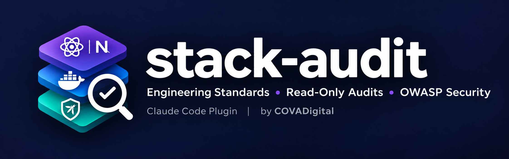

<div align="center">
  
</div>

# stack-audit

A plugin for [Claude Code](https://claude.com/claude-code) and [Codex CLI](https://developers.openai.com/codex) with engineering standards and **read-only** audits for React / Next.js apps, Postgres / Drizzle databases, Docker / Compose stacks, and OWASP-backed security guidance.

It gives your coding agent four skills, each with written standards, audit scripts that scan a project in seconds, and ready-to-use templates.

| Skill | Covers | Use it for |
|---|---|---|
| `web-standards` | React / Next.js: rendering, performance, state, networking, caching, architecture, security, accessibility and i18n, git hygiene. 179 rules, tuned for Next.js 16 and React 19. | Reviewing a file or PR, planning a page's rendering and caching, a pre-launch audit |
| `data-standards` | Postgres with Drizzle: schema design, migration safety (Drizzle Kit, Prisma and plain SQL migrations), push vs migrate, connections, roles, SSL, seeds, and PostgreSQL security hardening (patch level, pg_hba, TLS, roles and grants, row level security, views, functions, timeouts, logging) with an optional read-only snapshot of a live server. 48 rules. | Reviewing a schema or a migration before it runs, hardening a Postgres server, a database check before release |
| `container-standards` | Dockerfiles, Compose stacks, networks, published ports, secrets, volumes, Docker hosts, Coolify (with optional live checks of a Coolify server). 59 rules. | Reviewing a Dockerfile or Compose file, hardening a stack before deploy |
| `owasp-security` | The OWASP Cheat Sheet Series, ASVS 5.0 and the OWASP Top 10, from a local copy. | "What does OWASP recommend for X", citations for a security doc, an ASVS self-assessment |

## What you can ask

You don't need to name a skill. Ask normally and the agent loads the right one:

```text
review src/app/checkout/page.tsx before I open a PR
is compose.prod.yaml safe to deploy? read-only, don't change anything
is drizzle/0007_add_billing.sql safe to run on production?
harden our postgres: we store personal data for several tenants
what does OWASP recommend for password reset flows? I need the cheat sheet section
how do we stand against ASVS level 2? give me the gaps
audit this repo before launch: security, accessibility and the Docker setup
```

Or call a skill directly:

```text
/stack-audit:web-standards
/stack-audit:data-standards
/stack-audit:container-standards
/stack-audit:owasp-security
```

## Install

Requires Claude Code or Codex CLI, and Python 3.10 or later, available as `python` on your PATH. The scripts use the standard library only, so there is nothing to `pip install`. git is optional; with it, scans respect `.gitignore` and can check only changed files.

### Claude Code

From inside Claude Code:

```text
/plugin marketplace add COVADigital/stack-audit
/plugin install stack-audit@stack-audit
```

On Claude Code 2.1.275 or later this also works in one step:

```text
/plugin install stack-audit --marketplace COVADigital/stack-audit
```

To try it without installing, clone the repository and start Claude Code with:

```sh
claude --plugin-dir path/to/stack-audit
```

### Codex CLI

From a terminal:

```sh
codex plugin marketplace add COVADigital/stack-audit
codex plugin add stack-audit@stack-audit
```

Codex installs the same skills, scripts and hooks. Two differences:

- **Hooks need your approval once.** Codex skips plugin hooks until you review and trust them, so the first session asks you to trust stack-audit's start-up and edit hooks. Until you do, the skills still work, but Codex isn't told when to load them and edited files aren't checked.
- **No pre-approved scripts.** Codex runs the audit scripts under its own sandbox and approval settings. They only read files, so the default sandbox allows them. Flags that use the network (`--url`, `--audit`, `--remote`, `--image`) need your approval.

Update with `codex plugin marketplace upgrade stack-audit`, then start a new session.

| Feature | Claude Code | Codex CLI |
|---|---|---|
| Skills, rules, audit scripts, templates | yes | yes |
| Start-up hook (which skill to load) | yes | yes, after you trust it |
| Edit hook (checks each edited file) | yes (`Write`/`Edit`) | yes (`apply_patch`), after you trust it |
| Multiple-choice questions | AskUserQuestion | numbered questions in chat |
| Coolify add-on MCP server | yes | yes |
| Evals (`claude plugin eval`) | yes | no |

### Permissions (Claude Code)

In Claude Code's default permission mode, loading a skill needs your approval, so the first time a skill applies Claude asks before using it. The audit scripts inside each skill are pre-approved and then run without further prompts. To approve the four skills up front, add this to `~/.claude/settings.json` (or a project's `.claude/settings.json`):

```json
{
  "permissions": {
    "allow": [
      "Skill(stack-audit:web-standards)",
      "Skill(stack-audit:data-standards)",
      "Skill(stack-audit:container-standards)",
      "Skill(stack-audit:owasp-security)"
    ]
  }
}
```

With `claude -p` (scripts, CI), nothing can prompt you, so pass the same rules with `--allowedTools`. Otherwise the skills are blocked and Claude answers without the standards or the audits.

### One-time setup for `owasp-security`

The OWASP skill reads a local clone of the cheat sheets. Nothing is downloaded when you install the plugin. The first time you ask an OWASP question without the clone, the agent tells you it's missing and offers to run the command below; it runs only if you agree. You can also clone it yourself beforehand:

```sh
git clone https://github.com/OWASP/CheatSheetSeries.git ~/.claude/data/owasp-cheatsheets
```

To keep it somewhere else, set `STACK_AUDIT_OWASP_CHEATSHEETS` to the path.

### Optional: ASVS requirement text

Without it, ASVS answers work at section level (V3.3 Cookie Setup). With it, the agent can quote individual requirements (V3.3.1) with their level and a link. The text is OWASP's ASVS 5.0.0 release file (163 KB, CC BY-SA 4.0), downloaded separately and never bundled with the plugin. The agent offers the command the first time ASVS comes up and runs it only if you agree. To do it yourself:

```sh
curl -fsSL --create-dirs -o ~/.claude/data/owasp-asvs/asvs-5.0.0.flat.json \
  https://github.com/OWASP/ASVS/releases/download/v5.0.0_release/OWASP_Application_Security_Verification_Standard_5.0.0_en.flat.json
python skills/owasp-security/scripts/check_freshness.py --asvs   # checks the pinned SHA-256
```

The plugin refuses a file that doesn't match the pinned hash. To keep it elsewhere, set `STACK_AUDIT_OWASP_ASVS` to the file's path.

### Keeping the cheat sheets current

At the start of each session the plugin checks how long ago the clone was last updated. This is a local file check with no network access. If it has been more than 30 days, the agent tells you the next time an OWASP question comes up and offers to update it; it runs `git pull` only if you agree. The copy keeps working if you decline.

To update without being asked, turn on automatic updates. The plugin then pulls at session start, at most once every 30 days. It is off by default because it uses the network without asking first. Either set an environment variable:

```sh
STACK_AUDIT_OWASP_AUTO_UPDATE=1
```

or add this to `stack-audit.config.json` in a project:

```json
{ "owasp": { "autoUpdate": true } }
```

You can always update by hand with `git -C ~/.claude/data/owasp-cheatsheets pull --ff-only`.

### Optional: Coolify add-on

If you deploy with [Coolify](https://coolify.io), the plugin can also check the live server: public databases, database backups, pending OS updates, image vulnerability scans, secrets passed to builds, and server access settings. Everyone else can ignore this; the Compose checks work without it.

The first time Coolify comes up, the agent asks once whether you want the add-on and remembers the answer in `~/.claude/data/stack-audit/addons.json`. If you say yes:

1. The agent checks whether Claude Code and Codex CLI already have a `coolify` MCP server. Where one is missing, it asks which clients to set up and for your Coolify URL, then adds the server (`coolify_addon.py install --url https://your-coolify-host --client claude|codex|both`). Both configs read the token from the `COOLIFY_TOKEN` environment variable (Claude Code: header `Bearer ${COOLIFY_TOKEN}`; Codex: `--bearer-token-env-var`), so the token is never written into either config.
2. In Coolify, create an API token (**Keys & Tokens → API tokens**) with only the **read** permission. Add **read:sensitive** only if you want docker run options checked. Never give it write, deploy or root.
3. Store the token with `python skills/container-standards/scripts/coolify_addon.py set-token`. Run it in your own terminal so the token goes into a hidden prompt and never into the chat (recommended), or paste it to the agent, which passes it on stdin. It is saved as a user environment variable (Windows: your user environment; macOS/Linux: `~/.config/stack-audit/coolify.env`, mode 0600, sourced from your shell profile), and the connection is checked.
4. Restart Claude Code and Codex from a new terminal. On Windows, a new tab in an already-running Windows Terminal keeps the old environment. To stay in your current terminal, run `$env:COOLIFY_TOKEN = [Environment]::GetEnvironmentVariable('COOLIFY_TOKEN', 'User')` and then resume (`claude --continue` or `codex resume --last`). Codex starts MCP servers from a background app-server, so if `/mcp` still shows `coolify: failed`, run `codex app-server daemon stop` and `codex app-server daemon start` from a terminal that has `COOLIFY_TOKEN` (`set-token` offers to do this for you when you run it in your own terminal), and restart VS Code or the Codex desktop app if you use them. `coolify_addon.py verify` shows what each client sees.

The checks are strictly read-only. The agent asks which Coolify projects to audit, reads them with the connector's read tools only (never start, stop, deploy or change), reads environment variable names but never values, and saves the snapshot to a temporary folder outside your repository. To change your answer later, run `python skills/container-standards/scripts/coolify_addon.py set yes` (or `no`).

## How it works

- **A start-up hook** tells the agent when to load each skill, so a question like "review this file" uses the standards instead of an answer from memory.
- **An edit hook** checks each file the agent writes or edits (TypeScript/JavaScript, Drizzle schemas, SQL migrations, Dockerfiles, Compose files) for error-level findings, such as XSS sinks, hard-coded secrets, raw SQL, a migration that would fail on a table with rows, or a privileged container. It tells the agent straight away so the fix happens while the file is open. It runs offline in well under a second and says nothing when the file is clean. Turn it off with `STACK_AUDIT_ON_EDIT=0` or `{ "hooks": { "onEdit": false } }` in `stack-audit.config.json`.
- **Each skill is a `SKILL.md`** with reference files the agent reads only when it needs them. Findings cite rule IDs such as `sec.16`, which map to a section in the references.
- **Audit scripts** do the mechanical scanning and report `file:line` findings with a severity, a fix hint and the rule ID.
- **Missing scanners are offered, never installed silently.** Some checks use outside tools (hadolint, trivy, grype, gitleaks). If one isn't installed, the agent asks whether to run it once from its official container image, install it system-wide, or skip that check.
- **Checks worth repeating can be saved.** When the agent runs a check of its own that you're likely to need again, it asks whether to keep it one-off, save it as a test in your project's existing test suite, or save it as a standalone script. Nothing is saved without your say-so.
- **`owasp-security` quotes from the local clone**, by sheet and section with a link, and has a checker that verifies every citation exists. ASVS results are always labelled as a self-assessment, never as compliance or certification.

### Safety

- The audit scripts never modify the project they scan and never install anything.
- They make no network calls unless you pass an explicit flag: `--url` (probe a deployed site's headers), `--audit` (npm audit), `--remote` (GitHub settings) or `--image` (image vulnerability scan).
- The start-up hook only reads local files, unless you have turned on automatic cheat sheet updates. The edit hook only reads the file that was edited and the project's config.
- The Compose audit never reads env files or secret files, and never prints secret values.
- The Coolify audit reads only a snapshot file, refuses one that contains secret-shaped fields, and never prints commands or docker run options.
- The agent asks before running anything that contacts an external service.

## Use the audits without an agent

The scripts are plain command-line tools. They work in a terminal or CI, with no API usage:

```sh
# What stack is this project?
python scripts/stack_profile.py --root path/to/app

# All static web checks, or selected domains
python skills/web-standards/scripts/run_audit.py --root path/to/app --phase review
python skills/web-standards/scripts/run_audit.py --root path/to/app --domain sec,a11y

# Database: Drizzle schema, SQL migrations, push/migrate, connections, Postgres hardening (never connects to a database)
python skills/data-standards/scripts/run_audit.py --root path/to/app
# Live server state: run the read-only snapshot with psql, then pass it in
psql -X -d "$DATABASE_URL" -f skills/data-standards/assets/pg_snapshot.sql -o /tmp/pg-snapshot.jsonl
python skills/data-standards/scripts/run_audit.py --root path/to/app --pg-snapshot /tmp/pg-snapshot.jsonl --app-role app_user

# Dockerfiles and Compose files
python skills/container-standards/scripts/run_audit.py --root path/to/repo --phase build

# OWASP: find the right sheet, read one section, check citations in a document
python skills/owasp-security/scripts/find_sheets.py "csrf server actions"
python skills/owasp-security/scripts/read_section.py --sheet Session_Management --list
python skills/owasp-security/scripts/read_requirement.py --section V3.3 --level 2   # needs the ASVS file
python skills/owasp-security/scripts/verify_citations.py docs/security.md            # sheets, anchors and ASVS IDs
```

Conventions shared by every audit script:

- Options: `--root`, `--changed [--base REF]`, `--files PATH...` (individual audit scripts, not `run_audit.py`), `--format md|json|sarif`, `--out FILE`, `--strict`, `--config FILE`
- Exit codes: `0` ran (findings may exist) · `1` `--strict` and error findings remain · `2` usage or config error
- Findings: `rule` (for example `sec.16`), `severity` (error/warn/info), `confidence` (high/medium/low), `file:line`, `fix_hint`, `ref`, `owasp`

### Suppressing a finding

Inline, with a required reason:

```ts
// stack-audit-ignore sec.01 -- sanitized by DOMPurify in lib/html.ts
```

`#` and `{/* */}` comments work too, as do several rules (`sec.01,sec.14`) and a domain wildcard (`sec.*`). A suppression with no reason doesn't suppress anything and is reported as `meta.01`.

Per path, in `stack-audit.config.json` at the project root:

```json
{ "ignore": { "sec.01": ["src/legacy/**"] } }
```

## Templates

Each skill ships starting points the agent can adapt, in `skills/<name>/assets/`:

- **web-standards:** security headers for `next.config.ts`, a CSP proxy with nonces, `.gitignore`, Dependabot, pre-commit secret scanning, Lighthouse CI, an axe accessibility test, an ADR template, and a GitHub Actions workflow that runs the web, database and container audits on every PR and shows the findings in code scanning (`ci-stack-audit.yml`).
- **container-standards:** Dockerfiles for Next.js standalone and for a Node service, a hardened Compose file, `.dockerignore`, `daemon.json` with log rotation, a CI image-scan workflow.

## What has been measured

Tested with Claude Opus 5.5:

- **Loading:** with the start-up hook, each skill loaded on every test question it should (8 of 8 per skill) and on none of the unrelated ones.
- **`owasp-security`:** answers passed 8 of 8 checks with the skill and 4 of 8 without. Without it, the model missed that OWASP has a webhook cheat sheet and quoted a requirement number from memory.
- **`web-standards` and `container-standards`:** answers passed every check with the skills, and the model alone also passed every check, including on a 63-file project and a 12-service stack. Their practical value is the audit scripts: fast, repeatable, and free to run.

The test cases are in `skills/<name>/evals/`.

## Repository layout

```text
.claude-plugin/              plugin and marketplace manifests
assets/                      banner, icon and social preview images
hooks/                       SessionStart hook (when to load each skill, cheat sheet checks) and the edit hook
lib/wclib/                   shared Python library (stdlib only), used by all skills
scripts/                     shared CLIs (stack_profile.py)
skills/<name>/               SKILL.md, references/, scripts/, assets/, evals/
tests/                       unittest suite
```

Run the tests with:

```sh
python -m unittest discover -s tests -t tests
```

## Contributing and security

- **Contributing:** see [CONTRIBUTING.md](CONTRIBUTING.md) for how to report a false positive, run the tests and add a rule.
- **Security:** to report a vulnerability in the plugin, follow [SECURITY.md](SECURITY.md). Please don't open a public issue for it.
- **Conduct:** this project follows a [Code of Conduct](CODE_OF_CONDUCT.md).

## License and attribution

MIT. See [LICENSE](LICENSE).

The standards are written in the plugin's own words. The `owasp-security` skill cites the [OWASP Cheat Sheet Series](https://cheatsheetseries.owasp.org/) (CC BY-SA 4.0) and reads it from your own clone; no OWASP text is bundled. This project is not affiliated with or endorsed by OWASP, Vercel, Docker or Anthropic.
